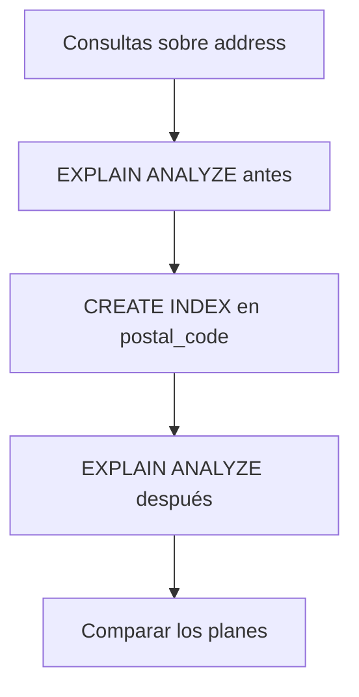

<!-- readme de la clase 17 | base de datos ii -->

<div align="center">

  

  <h1>⚡ Clase 17 · Índices y optimización de consultas</h1>

  <p><strong>Base de Datos II</strong> · Práctica de consultas, índices y búsquedas de texto en MySQL</p>

  <p>
    <a href="https://www.mysql.com/">
      
    </a>
    
    
    
  </p>

  <p>
    <a href="https://github.com/cromop1/Clase-17---Base-de-Datos/blob/main/Bruno_Segura_Clase_17.sql">
      
    </a>
    <a href="https://dev.mysql.com/doc/refman/8.0/en/optimization-indexes.html">
      
    </a>
    <a href="https://github.com/cromop1">
      
    </a>
  </p>

  <sub>Una práctica para ver cómo cambian los planes de ejecución cuando utilizamos índices y distintos métodos de búsqueda</sub>

</div>

---

## 📌 Sobre el trabajo

En esta clase trabajé con **índices de MySQL** y con herramientas para analizar cómo el motor ejecuta distintas consultas. La idea fue probar búsquedas sobre la base de datos **Sakila**, agregar índices donde correspondía y comparar los planes de ejecución usando `EXPLAIN ANALYZE`.

El trabajo está dividido en **tres ejercicios**: filtros y `JOIN` sobre direcciones, consultas sobre actores y búsqueda de palabras dentro de descripciones de películas.

<table>
  <tr>
    <td align="center"><strong>01</strong><br/><sub>Índices</sub></td>
    <td align="center"><strong>02</strong><br/><sub>Planes de ejecución</sub></td>
    <td align="center"><strong>03</strong><br/><sub>Búsqueda de texto</sub></td>
  </tr>
  <tr>
    <td align="center"><code>CREATE INDEX</code></td>
    <td align="center"><code>EXPLAIN ANALYZE</code></td>
    <td align="center"><code>LIKE / FULLTEXT</code></td>
  </tr>
</table>

### 🧭 Navegación

- [Objetivos](#-objetivos)
- [Tecnologías y requisitos](#-tecnologías-y-requisitos)
- [Estructura del repositorio](#-estructura-del-repositorio)
- [Ejercicio 1 · Índice en direcciones](#-ejercicio-1--índice-en-direcciones)
- [Ejercicio 2 · Búsquedas en actores](#-ejercicio-2--búsquedas-en-actores)
- [Ejercicio 3 · LIKE y FULLTEXT](#-ejercicio-3--like-y-fulltext)
- [Cómo ejecutar el SQL](#-cómo-ejecutar-el-sql)
- [Qué observar al comparar](#-qué-observar-al-comparar)
- [Recursos](#-recursos)

---

## 🎯 Objetivos

- Consultar los índices existentes con `SHOW INDEX`
- Filtrar registros usando `IN` y `NOT IN`
- Relacionar tablas mediante `JOIN`
- Crear un índice en una columna utilizada para búsquedas
- Observar planes y tiempos de ejecución mediante `EXPLAIN ANALYZE`
- Comparar filtros tradicionales de texto con una búsqueda `FULLTEXT`

## 🛠️ Tecnologías y requisitos

<div align="center">
  
</div>

| Herramienta | Uso en la práctica |
| :-- | :-- |
| **MySQL** | Ejecutar consultas y crear índices |
| **Sakila** | Base de datos de ejemplo con tablas de películas, actores y direcciones |
| **MySQL Workbench** o cliente SQL | Abrir y ejecutar el archivo |
| **`EXPLAIN ANALYZE`** | Revisar cómo se ejecutan las consultas |

> [!IMPORTANT]
> Se necesita **MySQL 8.0.18 o superior** para utilizar `EXPLAIN ANALYZE`. La base `sakila` debe estar importada antes de ejecutar el script.

## 📂 Estructura del repositorio

```text
Clase-17---Base-de-Datos/
├── Bruno_Segura_Clase_17.sql  # resolución de los ejercicios
└── README.md                  # documentación
```

📄 **[Abrir el archivo SQL](./Bruno_Segura_Clase_17.sql)**

---

## 🧪 Ejercicio 1 · Índice en direcciones

El primer ejercicio utiliza la tabla `address`. Primero se revisan los índices que ya tiene y después se hacen consultas con códigos postales específicos. También se relacionan las direcciones con sus respectivas ciudades y países.

**Tablas utilizadas:** `address`, `city` y `country`.

<details>
<summary><strong>🔎 Ver las consultas utilizadas</strong></summary>

```sql
SHOW INDEX FROM address;

SELECT address_id, address, postal_code
FROM address
WHERE postal_code IN ('35200', '17886', '53561');

SELECT address_id, address, postal_code
FROM address
WHERE postal_code NOT IN ('35200', '17886', '53561');
```

Consulta que combina direcciones, ciudades y países:

```sql
SELECT dir.address, dir.postal_code, ciudad.city, pais.country
FROM address dir
JOIN city ciudad ON dir.city_id = ciudad.city_id
JOIN country pais ON ciudad.country_id = pais.country_id
WHERE dir.postal_code IN ('35200', '17886', '53561');
```

</details>

### 📈 Comparación antes y después del índice

En el archivo se utiliza `EXPLAIN ANALYZE` **antes** de crear el índice y luego se vuelven a analizar las mismas tres consultas.

```sql
CREATE INDEX indice_codigo_postal ON address(postal_code);
```

La comparación busca observar si hay diferencias en el acceso a los registros, en la cantidad de filas procesadas y en el tiempo de ejecución.



> [!NOTE]
> Un índice no garantiza que cada consulta sea más rápida. MySQL decide si conviene utilizarlo según la consulta y los datos. En especial, `NOT IN` puede procesar muchas filas y no beneficiarse tanto de ese índice.

---

## 🎭 Ejercicio 2 · Búsquedas en actores

En el segundo ejercicio se consulta la tabla `actor` para buscar registros por **nombre** y por **apellido**, y después se inspecciona el plan de ejecución de cada búsqueda.

| Campo | Valor usado en el SQL | Consulta |
| :-- | :-- | :-- |
| `first_name` | `PENELOPE` | Búsqueda por nombre |
| `last_name` | `GUINESS` | Búsqueda por apellido |

<details>
<summary><strong>💻 Mostrar el código del ejercicio</strong></summary>

```sql
SHOW INDEX FROM actor;

SELECT * FROM actor
WHERE first_name = 'PENELOPE';

SELECT * FROM actor
WHERE last_name = 'GUINESS';

EXPLAIN ANALYZE
SELECT * FROM actor
WHERE first_name = 'PENELOPE';

EXPLAIN ANALYZE
SELECT * FROM actor
WHERE last_name = 'GUINESS';
```

</details>

**¿Qué se analiza?** Si existe un índice adecuado para cada búsqueda y qué estrategia elige MySQL al ejecutar las consultas. La existencia de un índice se comprueba con `SHOW INDEX`; no se asume que ambas columnas tengan el mismo tratamiento.

---

## 🔤 Ejercicio 3 · LIKE y FULLTEXT

Este ejercicio prueba **dos formas de buscar la palabra `documentary`** dentro de descripciones de películas.

<details open>
<summary><strong>01 · Búsqueda con LIKE</strong></summary>

Se usa `LIKE` sobre la tabla `film`, con `%` a ambos lados para buscar la palabra dentro de la descripción:

```sql
SELECT film_id, title, description
FROM film
WHERE description LIKE '%documentary%';
```

El mismo filtro se analiza con `EXPLAIN ANALYZE`.

</details>

<details open>
<summary><strong>02 · Búsqueda con FULLTEXT</strong></summary>

En la tabla `film_text`, el script revisa primero los índices y después crea un índice de texto completo sobre `description`:

```sql
SHOW INDEX FROM film_text;

CREATE FULLTEXT INDEX indice_descripcion
ON film_text(description);
```

La búsqueda utiliza `MATCH ... AGAINST` en modo de lenguaje natural:

```sql
SELECT film_id, title, description
FROM film_text
WHERE MATCH(description) AGAINST('documentary' IN NATURAL LANGUAGE MODE);
```

También se ejecuta esta consulta con `EXPLAIN ANALYZE`.

</details>

### ⚖️ Diferencias principales

| Característica | `LIKE '%documentary%'` | `MATCH ... AGAINST` |
| :-- | :-- | :-- |
| Tabla del ejercicio | `film` | `film_text` |
| Método | Coincidencia de patrón | Búsqueda de texto completo |
| Índice específico | No se crea uno para esta consulta | Se crea un índice `FULLTEXT` |
| Tipo de coincidencia | Subcadena de texto | Búsqueda de términos según reglas de MySQL |
| Análisis del plan | `EXPLAIN ANALYZE` | `EXPLAIN ANALYZE` |

> [!TIP]
> Estas búsquedas no son exactamente equivalentes: `LIKE` y `FULLTEXT` pueden devolver resultados distintos, y el código consulta **dos tablas diferentes**. Sirven para comparar enfoques, pero no para concluir solamente con esta prueba que uno siempre es más rápido que el otro.

---

## 🚀 Cómo ejecutar el SQL

**Opción 1 · MySQL Workbench**

1. Descargar o clonar el repositorio
2. Tener instalada e importada la base de datos `sakila`
3. Abrir `Bruno_Segura_Clase_17.sql` desde Workbench
4. Seleccionar la conexión de MySQL y ejecutar las consultas en orden
5. Comparar los resultados de `EXPLAIN ANALYZE` antes y después de crear los índices

**Opción 2 · Terminal**

```bash
git clone https://github.com/cromop1/Clase-17---Base-de-Datos.git
cd Clase-17---Base-de-Datos
mysql -u root -p < Bruno_Segura_Clase_17.sql
```

<details>
<summary><strong>⚠️ ¿Qué pasa si ya ejecuté el script antes?</strong></summary>

El archivo contiene instrucciones `CREATE INDEX`. Si se vuelve a ejecutar sin cambios y esos índices ya existen, MySQL puede responder con un error por **nombre de índice duplicado**.

Lo ideal para repetir la comparación es utilizar una copia de prueba de `sakila` y verificar los índices existentes antes de intentar crearlos nuevamente.

</details>

## 📊 Qué observar al comparar

Al revisar la salida real de `EXPLAIN ANALYZE`, conviene prestar atención a:

| Elemento | ¿Qué permite observar? |
| :-- | :-- |
| **Tipo de acceso** | Cómo MySQL accede a las filas de una tabla |
| **Filas estimadas y reales** | Cuántas filas se esperaba procesar y cuántas se procesaron |
| **Tiempo real** | Cuánto tardaron los operadores del plan |
| **Uso de índices** | Si el optimizador eligió un acceso mediante índice |
| **Orden de ejecución** | Cómo se combinan filtros, lecturas y `JOIN` |

**En el repositorio está el código para realizar las pruebas, no un informe con mediciones capturadas.** Los resultados concretos dependen de la versión, el entorno y el contenido de la base.

---

## 📚 Recursos

- 📘 [MySQL Reference Manual — Optimization and Indexes](https://dev.mysql.com/doc/refman/8.0/en/optimization-indexes.html)
- 🔬 [MySQL Reference Manual — EXPLAIN](https://dev.mysql.com/doc/refman/8.0/en/explain.html)
- 🔎 [MySQL Reference Manual — Full-Text Search](https://dev.mysql.com/doc/refman/8.0/en/fulltext-search.html)
- 🗃️ [MySQL Sakila Sample Database](https://dev.mysql.com/doc/sakila/en/)

---

<div align="center">
  <p><strong>👨‍💻 Bruno Segura</strong></p>
  <p>Base de Datos II · Clase 17</p>
  <p>
    <a href="https://github.com/cromop1">
      
    </a>
    <a href="https://github.com/cromop1/Clase-17---Base-de-Datos">
      
    </a>
  </p>
  <sub>Práctica académica · MySQL + Sakila</sub>
</div>
